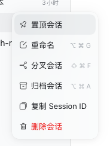

# dsh-session-manager

一个包含 Host 和 Web Client 的 DSH 插件，为 DSH Web 的会话记录和会话详情补充以下能力：

- **就地回退对话**：每条用户消息旁的 ↶ 按钮，一键回退到该消息之前的任意更早消息——同窗口内完成，不 fork 新会话；可选「回退对话和代码」一并还原被改动的文件（方案移植自 [SiriLee/dsh-rewind](https://github.com/SiriLee/dsh-rewind)，MIT）；
- **编辑用户提示词**：每条用户消息旁的 ✎ 按钮，回退到该消息并把文本回填输入框，改完手动重发——同回合重写生成请求；
- 在会话记录菜单的“归档会话”下方添加“删除会话”；
- 在助手消息操作区添加“重新生成”，重新生成当前助手回复，而不是继续发送新的提示词；
- 在会话详情顶部固定“最近用户消息”提示条：长回复向上滚动时，最近一条滚出视口顶部的用户消息悬浮在顶部，点击可跳回原消息；
- 在设置面板提供“会话管理”分区，可分别开关上述功能。

## 设置

打开 DSH Web 的「设置」→「会话管理」，可分别开关：

| 开关 | 作用 |
| --- | --- |
| 提示词悬浮 | 顶栏固定最近一条用户消息；关闭后立即移除提示条 |
| 删除会话 | 会话记录下拉菜单中的“删除会话”；关闭后立即还原菜单 |

设置命名空间为 profile entry id `dsh-session-manager`。Host 的两个 Config 字段标记为 volatile，由 SettingsForms 自动投影；Client 通过 `ctx.configForms.get('dsh-session-manager')` 读写，功能随设置快照实时安装或卸载，不需要重启。

若提示设置不可用，确认 DSH 版本至少为 `0.2.0-rc.2`，profile bundles 包含插件。本地 `link:` 安装在源码修改后需要重新 `pnpm build`，重启对应 DSH profile 并刷新浏览器，以同步 Host 和 Client 产物。连接采用 memory 模式时无法保存 Host 设置，请在 DSH 所在电脑通过 localhost 访问。

## 功能效果

### 删除当前会话

打开会话记录中的 `...` 菜单，在“归档会话”下面点击“删除会话”，即可删除当前会话。



### 回退对话（↶）

在会话详情中找到要回退到的用户消息，点击其操作区的 ↶ 按钮：

1. 浮层提供两种模式——「仅回退对话」或「回退对话和代码」；后者先展示文件影响清单再确认；
2. 回退立即生效：目标消息及其后的对话从视图与模型上下文中撤回，目标消息文本自动回填输入框，改完直接重发；
3. 也可直接输入 `/rewind`（或别名 `/undo`）回退最近一条用户消息；
4. 会话日志只追加、从不改写——被撤回的内容仍完整保留在日志中，可审计；
5. 文件还原基于写前备份（write/edit 落盘前捕获原字节）+ 消息边界重扫已跟踪文件，存储于 `~/.dsh/dsh-session-manager/rewind-snapshots/`，不依赖 git；
6. 预演（影响清单）到执行之间被外部改动的文件按安全规则拒绝覆盖，不误伤。

### 重新生成当前助手回复

在会话详情中找到需要重新生成的助手消息，点击消息操作区的“重新生成”：

1. 插件只针对当前这一条助手回复发起重新生成；
2. 原回复会被替换或先移除再生成，不会追加一条新的用户提示词；
3. 不会把重试行为变成“继续发送新消息”；
4. 生成期间页面保持当前会话上下文，不应出现白屏。

## 使用方式

### 1. 构建插件

```bash
pnpm install
pnpm build
```

### 2. 安装到 DSH Web profile

将下面的路径替换成插件实际所在目录：

```bash
dsh plugin --profile web add link:/path/to/dsh-session-manager
```

然后重启 DSH Web：

```bash
dsh --profile web
```

已有 `link:` 指向同一插件目录时，重新构建并重启即可，无需反复移除和安装。

### 3. 开始使用

- 进入任意会话，在会话记录菜单中使用“删除会话”；
- 在助手消息的操作区使用“重新生成”；
- 修改源码后重新执行 `pnpm build`，再重启对应的 `dsh web` profile，避免继续加载旧的 Client bundle。

## 兼容性

- DSH：`>=0.2.1-rc.1 <0.3.0-0`
- Host：需要 `commands`、`tools`、`settings` 服务（fs / workingDirectory 动态注入，缺席时文件备份自动降级）；
- Web Client：需要提供 `slots`、`workspaces`、`sessions` 和 `configForms` 注入能力。

## 升级与旧数据

从旧版（fork 式回滚）升级后：

- 旧的检查点快照目录 `~/.dsh/dsh-session-manager/<会话id>/<seq>.json` 与 `lineage.json` 不再被读取，可手动删除；
- 新的文件备份位于 `~/.dsh/dsh-session-manager/rewind-snapshots/`；
- `/snapshot-auto-cleanup` 命令可查看/配置/执行快照清理（默认关闭）。

## 实现说明

删除操作调用宿主公开的 `archiveSession` 能力。DSH 当前没有会话行菜单 Slot，因此菜单按钮使用兼容层插入，并在插件卸载时清理监听器、观察器和动态菜单项。

重新生成操作以当前助手消息为作用域，不能通过发送新的用户消息来模拟重试；实现时需要处理原消息替换、生成中状态、取消、异常和卸载清理。

插件包通过 `package.json` 的 `exports["./client"]` 和 `dsh.client` 配置加载 Client bundle；Host 入口注册 `/rewind`、`/undo`、内部引擎通道与 `/snapshot-auto-cleanup` 命令，并维护写前备份检查点存储（`src/snapshot.ts`，完整移植自 dsh-rewind，含崩溃恢复 journal）；Client 侧 ↶ 按钮沿用本仓的 DOM 注入骨架，浮层/隐藏行/输入框回填移植自 dsh-rewind（`src/client/popover.ts`、`src/client/hidden.ts`）。

## 开发

```bash
pnpm install
pnpm typecheck
pnpm test
pnpm build
```
